# OM Kamera

Open camera software for **Sony cameras with PlayMemories Camera Apps** – 28 models from 2012 to
2016, from the NEX-5R to the a6500 and RX100 V. OM Kamera replaces the whole shooting interface –
live view, menus, Fn menu, sequences – **without flashing**: it runs as an app on top of Sony's
untouched firmware, built on [OpenMemories](https://github.com/ma1co/OpenMemories-Framework).

Highlights: a menu modelled on Sony's newer cameras, Holy Grail time-lapse, RAW stacking in the
camera, a browser remote and an **MCP interface** – the open standard that lets AI assistants such
as Claude use tools, so you can ask the assistant in plain language and it operates the camera.

Tested on the a6000 and a7II; it should run on all PlayMemories cameras – see [Cameras](#cameras),
reports welcome.

The display is available in **English and German** (Setup → Sprache / Language).

> Status: personal project, works well on the author's cameras. Use at your own risk –
> the app talks to undocumented camera interfaces.

## Screenshots

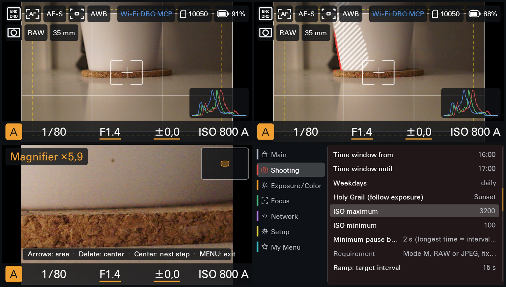

| Zebra and focus peaking | Focus magnifier |
|---|---|
|  | 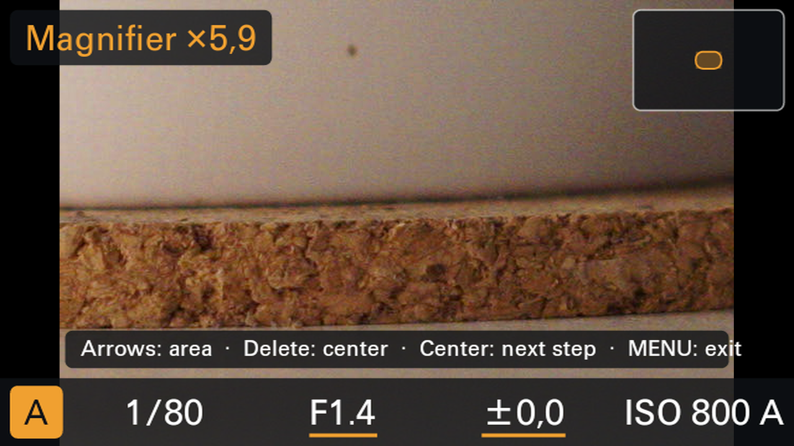 |

| Time-lapse (LRT) with BULB | Daily time window and weekdays |
|---|---|
| 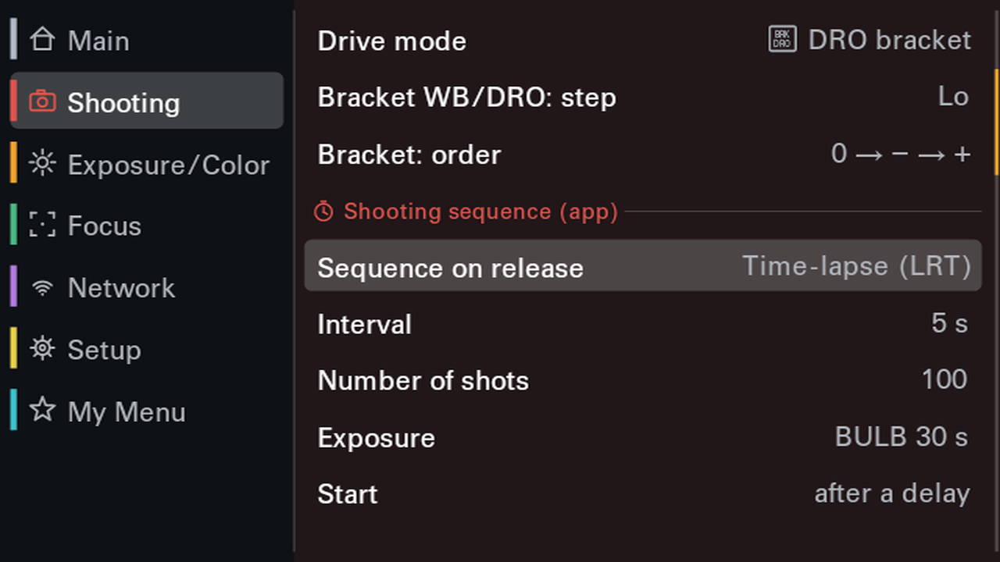 | 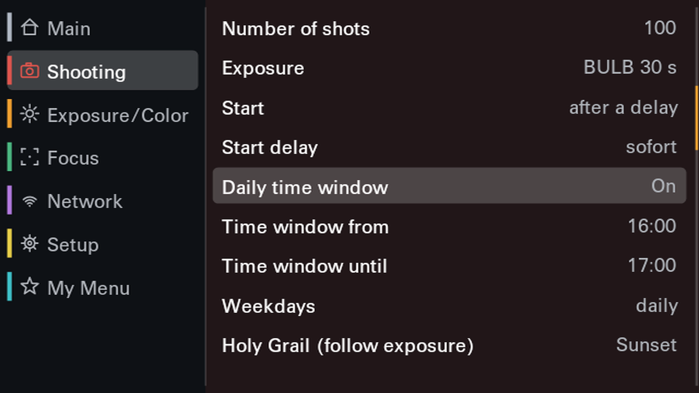 |

| Holy Grail exposure ramping | RAW processing on the camera |
|---|---|
| 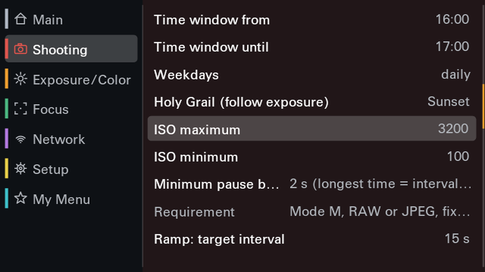 | 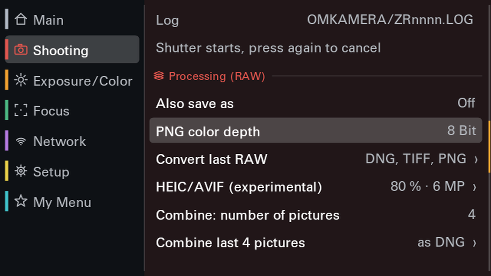 |

| Live view with status line and RGB histogram | Fn menu |
|---|---|
| 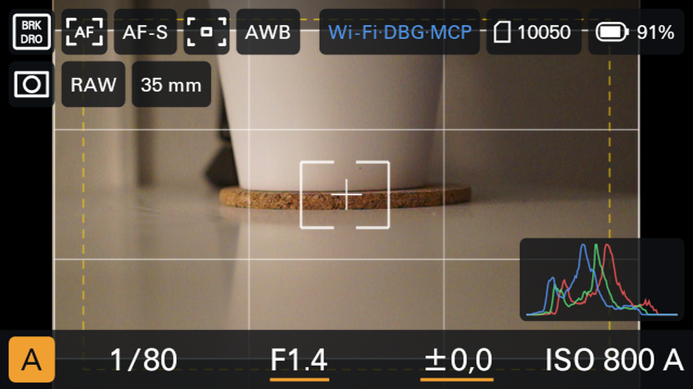 | 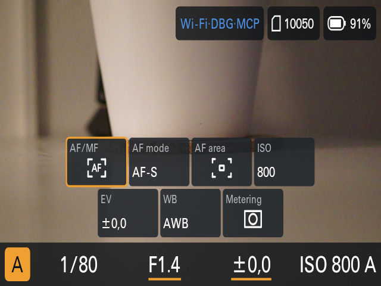 |

| Main | Shooting |
|---|---|
| 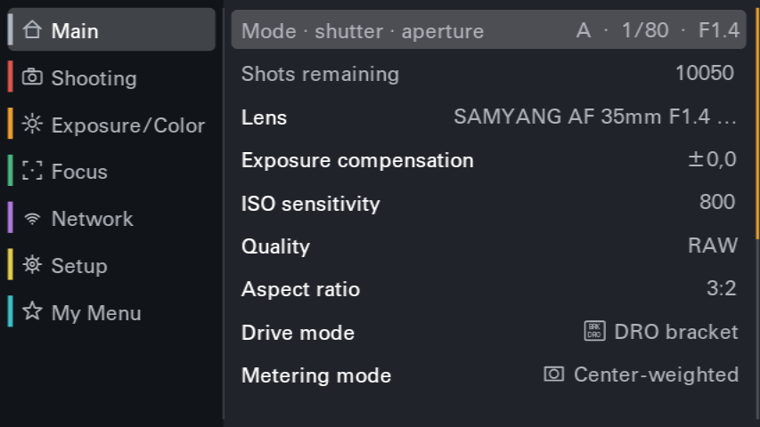 | 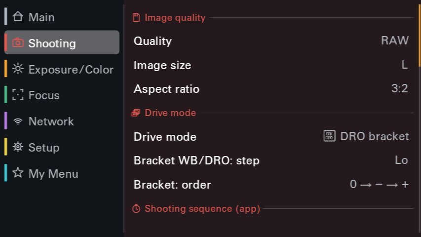 |

| Exposure/Color (auto ISO with minimum shutter speed) | Focus |
|---|---|
| 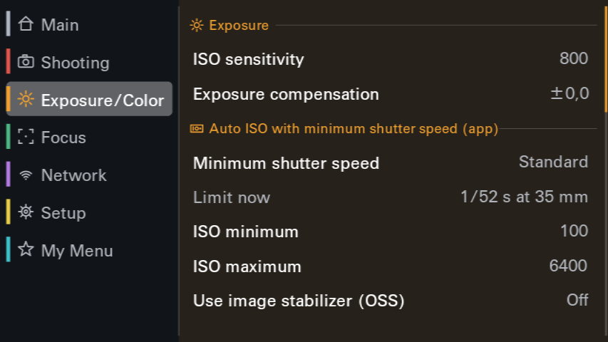 | 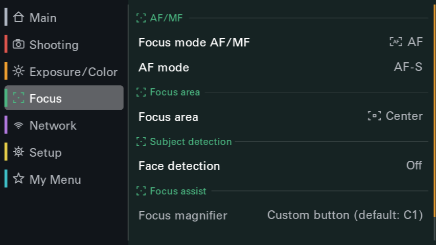 |

| Setup: clock (NTP correction) | Setup: operation, language, direct start |
|---|---|
| 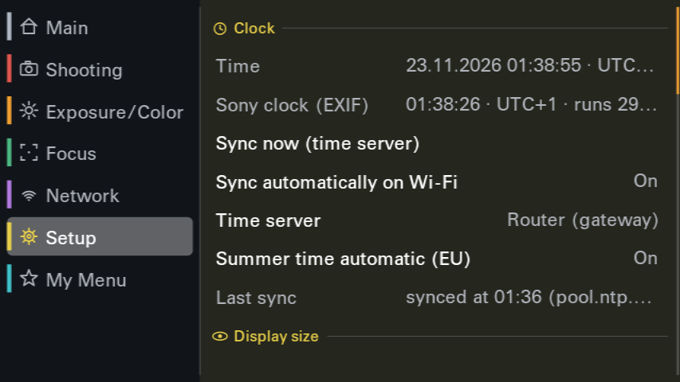 | 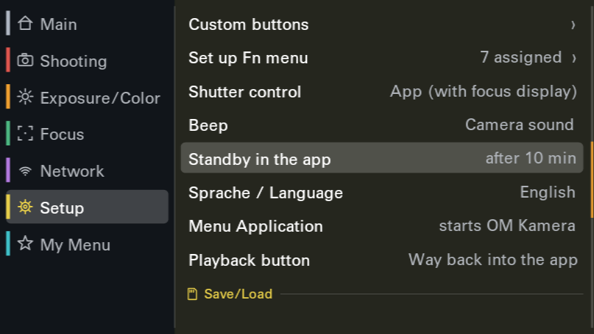 |

**Remote control in the browser** – live view with the camera display, exposure, camera buttons and all settings:

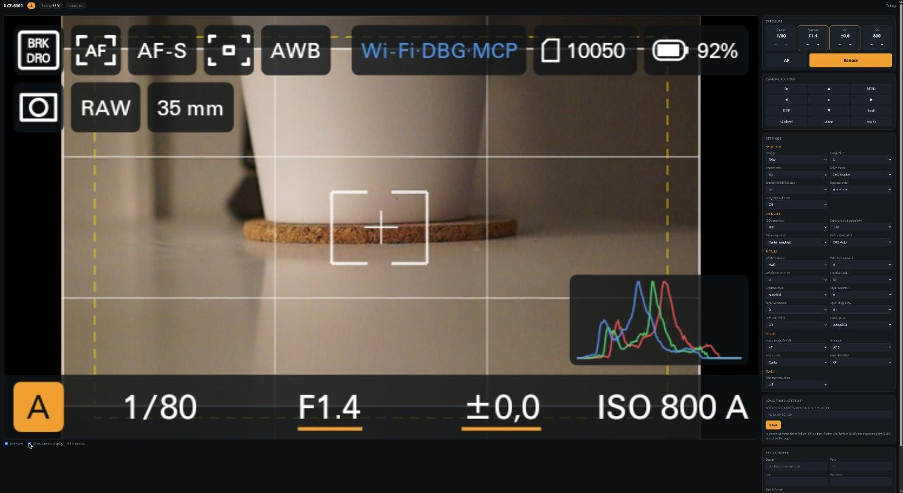

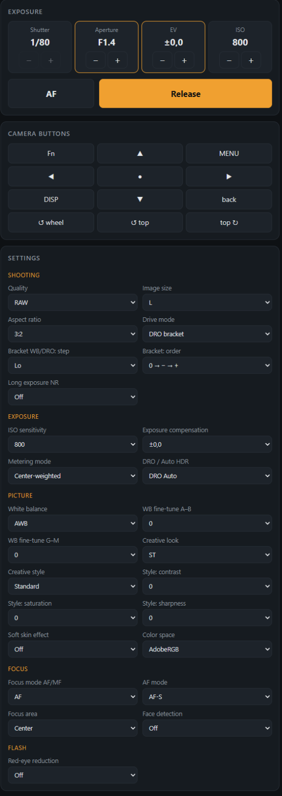

## Features

**Shooting**
* Current focal length, live while zooming, with the 35 mm equivalent in brackets – "28 mm (42)" on
  APS-C bodies and in the APS-C mode of the a7 models; Sony's own display does not show it
* Live view with exposure bar, histogram, grid lines (3×3, golden ratio, square, diagonal), level marker,
  zebra and focus peaking, warnings (camera shake, clipped highlights, battery, card)
* Fn menu with up to 18 freely assigned slots, menu with tabs and "My Menu", freely assignable custom buttons
* Auto ISO with a minimum shutter speed (by focal length or fixed)
* Long exposures beyond 30": own list of times (e.g. 40", 90", 5'), exposed with BULB and timed by the app;
  BULB timer
* Level (electronic spirit level) where the camera delivers sensor data to apps (a7 models; the a6000 does not)

**Extra on newer bodies** (only shown when the camera reports it, e.g. a7II)
* Uncompressed RAW (14-bit)
* Manual lenses: name, focal length and aperture written into the EXIF of every picture, SteadyShot set
  to the focal length, shown in the status line and used by Auto ISO – set on the camera or via MCP
  ("I have the Helios 44-2 on, 58 mm, F2, set to F4")
* Expanded ISO 50–80

**Sequences**
* Interval shooting and time-lapse (LRT) with start delay, start at a time of day, daily time window and weekdays
* BULB time-lapse, "Holy Grail" exposure ramping for sunsets/sunrises, interval ramp
* Preview movie (MJPEG AVI) and a log file for each run
* Exposure bracketing+, focus bracketing (where the camera allows focus control)

**RAW processing on the camera**
* Combine the last N RAWs: average (less noise), sum, maximum (star trails, light trails), focus stacking
* Export as DNG, 16-bit TIFF, PNG; HEIC/AVIF (experimental)
* Native ARW decoder (multi-threaded C, ARM mode)

**Connectivity**
* Remote control in the browser (live view, settings, shutter) with an access code
* MCP interface for AI assistants (token protected), bridge in `tools/mcp-bridge`
* Upload of new pictures to a NAS or Windows share (SMB 2.0 to 3.1.1 with signing and encryption,
  own pure-Java client) or to an FTP server – set up in the remote page, with progress in the status line
* Update notice: the remote page checks GitHub for new releases; `tools/omk-update.ps1` installs them over USB
* Clock correction via NTP (the a6000 cannot set its clock from apps; the app keeps the offset)
* Read-only system diagnostics with root rights (fixed queries, no free commands)

**Integration**
* Direct start: "Application" in the Sony menu opens OM Kamera directly (optional);
  open "Application" within 20 s after closing the app to get the normal app list

## Cameras

Sony offered PlayMemories Camera Apps on 28 models, from the NEX-5R (2012) to the a6500 and
RX100 V (2016); the app store closed on 31 August 2025. OM Kamera installs without it. All of them
share the same platform, so OM Kamera should run on every one; it adapts to the sensor size and the
features each body reports. Tested so far on two:

| Status | Models |
|---|---|
| Tested | ILCE-6000 (a6000), firmware 3.21 · ILCE-7M2 (a7II), firmware 4.01 |
| Interchangeable lens, should work | ILCE-5000, ILCE-5100, ILCE-6300, ILCE-6500, ILCE-7, ILCE-7R, ILCE-7RM2, ILCE-7S, ILCE-7SM2, NEX-5R, NEX-5T, NEX-6 |
| Compact, should work | DSC-RX100M3, RX100M4, RX100M5, RX10M2, RX10M3, RX1RM2, HX60(V), HX80, HX90(V), HX400(V), WX500 |

**Reports welcome:** tried it on another model? Please open an [issue](../../issues) with the model,
the firmware and what works or does not – the table grows with every report.

## Forks and patches

Side work from getting the tools to run again:

* [rony-x2/fwtool.py](https://github.com/rony-x2/fwtool.py) – unpacks Sony firmware updates; support
  for repackaged updaters and current Python, sent upstream as
  [ma1co/fwtool.py#57](https://github.com/ma1co/fwtool.py/pull/57)
* [rony-x2/OpenMemories-Framework](https://github.com/rony-x2/OpenMemories-Framework) – build on
  Gradle 8 (branch `modernize-build`)
* [rony-x2/OpenMemories-Tweak](https://github.com/rony-x2/OpenMemories-Tweak) – build on Android
  Gradle plugin 8, native part on the C++ string ABI the camera expects (branch `modernize-build`)

## Installing

Download the APK from the [releases](../../releases) and install it with
[Sony-PMCA-RE](https://github.com/ma1co/Sony-PMCA-RE):

    pmca-console install -f OM-Kamera-<version>.apk

### Updates

The remote page in the browser checks GitHub for a newer release (at most every 12 hours) and
shows an "Update" chip; the camera then lists the new version under Setup → App version. The
camera itself cannot reach GitHub – its Android is too old for current HTTPS – and apps can only
be installed over USB, so the update itself runs on the computer:

    .\tools\omk-update.ps1 -Pmca C:\path\to\pmca-console.exe

It downloads the newest APK and installs it on the camera connected by USB. With the MCP bridge,
the assistant can do the same with the bridge tools `update_pruefen` and `update_installieren`.
The update notice can be switched off under Setup → Update notice.

## Building

Requires the Android SDK (platform 10 is enough) and, for the native parts, NDK r14b.
The Sony API stubs and the framework wrappers from
[OpenMemories-Framework](https://github.com/ma1co/OpenMemories-Framework) are in `app/libs`.

    ./gradlew assembleDebug

The native libraries are prebuilt in `app/src/main/jniLibs/armeabi`; to rebuild them run
`ndk-build` in `native/` (see `native/THIRD_PARTY.md` for the HEIC/AVIF encoders).

## Translation

The app is written in German; English is applied when text is drawn, from
`app/src/main/assets/lang/en.tsv` (German text, tab, English text). Texts that stay German in the
English display are listed by the app at `/api/i18n` (remote control code required).

## License

MIT, see [LICENSE](LICENSE). Third-party parts keep their own licenses
(OpenMemories, Kvazaar, libaom).
